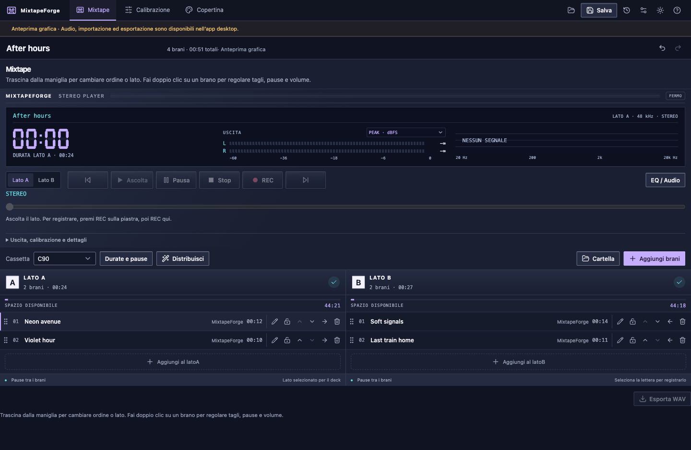

# MixtapeForge

**A local, open-source workbench for making real cassette mixtapes.**

Arrange side A and side B, prepare the sound for your deck, measure your recording chain and print the J-card. MixtapeForge is a desktop application built with Tauri, React/TypeScript and Rust.



*Visual browser preview of the demo project; recording and audio output require the desktop app.*

## Project status

**Desktop prototype 0.1.** The macOS application has been built and tested locally. Windows and Linux have build configuration and a verification workflow; hardware playback and installable releases still need qualification on each platform. No signed or notarized public installer is currently linked here. Full feature parity with MixtapeNerd has not been reached.

The website is in [website/](website/README.md), with English, Italian, French, German and Spanish pages and guides. Once deployed, its URL appears in the GitHub Pages deployment. The desktop interface currently has Italian, English, French and Spanish translations.

## The workbench

- **Mixtape:** arrange tracks across both sides, trim, add gaps and fades, check capacity and prepare native playback to the deck.
- **Audio:** level normalization, ten-band EQ with editable genre presets, compression, peak protection and an optional external stereo VST3 effect.
- **Calibration:** record a guided test of about 108 seconds, capture or import its playback, inspect the chain and save an optional conservative recording profile.
- **J-cards:** nine artwork styles, six bundled fonts, suggested and custom colours, monochrome output, PDF/SVG export and system printing.
- **Projects:** local saves, recovery, backups and portable project support.

Your computer plays the prepared audio to the selected output. The physical deck controls the tape transport and records the signal: you still press **REC on the deck**.

## First recording

1. Connect your computer or audio interface output to the deck's **LINE IN**.
2. Import local files, select the tape length and arrange both sides.
3. Select the correct audio output and make a short level check. Set the deck's REC LEVEL without audible overload.
4. Move beyond the non-recordable leader, press REC on the deck and start the side in MixtapeForge.
5. Record side B, listen back with the intended playback settings, then create and print the J-card at **100% scale**.

Common WAV, FLAC, MP3, Ogg Vorbis and AIFF sources are decoded by the audio engine. Some codec variants and damaged files may fail; test unusual sources before a long recording. Native playback uses an internal float32 master. The browser preview is visual only; native audio, file operations and exports require the desktop app.

## Noise reduction and measurement limits

Optional **Type B encoding** uses libdolbyb 1.1 through a separately executed utility. Level alignment and playback checks remain necessary. This is not a certified replacement for every hardware Dolby B encoder. Avoid encoding twice: if the app encodes, disable NR encoding on the recording deck and use the intended decoder on playback. Dolby C, Dolby S, dbx and automatic NR detection are not implemented.

Calibration profiles describe the complete record/playback path. Without a suitable reference tape they do not independently establish playback alignment, absolute playback speed or azimuth. EQ cannot repair unstable transport, damaged tape or mechanical faults. The guided test does not certify MOL, wow/flutter or Dolby compatibility.

One external **stereo VST3 effect** can be hosted at a time. The host is packaged with the app; plugins are installed separately and retain their own licenses. Do not use this effect slot as an NR encoder stage.

## Application identity

The public application name is **MixtapeForge** in every language. Existing project files, recovery data, recording profiles and preferences retain their current format and storage keys. The native application identifier and internal executable name remain unchanged so this update uses the same application data directory. Older development notes may still use the initial working name.

## Build the desktop app

Install Node.js 22, stable Rust, CMake ≥3.22 and the [Tauri prerequisites](https://v2.tauri.app/start/prerequisites/) for your operating system. Linux also requires ALSA development headers.

```sh
git submodule update --init --recursive
npm ci
npm run desktop
```

```sh
npm run desktop:build
```

On macOS the local bundle is generated under `src-tauri/target/release/bundle/macos/` and targets macOS 13 or later. Local builds are not automatically signed or notarized public distributions. The manually triggered **Desktop packages** workflow builds Apple Silicon, Intel and Windows x64 packages as downloadable Actions artifacts; it does not publish a release. See [desktop packaging](docs/54-pacchetti-desktop.md). Windows installers include WebView2 and the Visual C++ runtime when needed.

```sh
npm run dev
```

This last command starts the **visual browser preview** on port 1420, not the full desktop application.

## Verify changes

```sh
npm test
npm run build
cargo test --locked --manifest-path src-tauri/Cargo.toml --lib
cargo clippy --locked --manifest-path src-tauri/Cargo.toml --all-targets -- -D warnings
cargo run --locked --manifest-path src-tauri/Cargo.toml --features tools --bin verify -- test-results/audio
```

The `verify` binary exercises import/render, audio processing, fades, project portability and artwork output. `list_devices` inspects available native audio devices without playing sound. `playback_check` and `check_output` intentionally emit audio; read their source and set a moderate listening level before running them.

## Website

The Astro site is independent of Tauri and requires **Node.js 24 LTS** (minimum 22.23.4).

```sh
cd website
npm ci
npm run dev
```

Open `http://127.0.0.1:4321/en/` or choose another language. [Website setup and deployment](website/README.md) explains checks, custom domains and repository paths. The Website action publishes static files to `gh-pages` and deploys GitHub Pages from the same checked artifact. Enable **GitHub Actions** in repository Settings → Pages before the first deployment.

## Contributing

Report the operating system, app version, selected input/output, sample rate and reproducible steps for audio problems. For measurements include tape/deck identity, NR settings and which part of the chain was captured. Avoid posting private audio or unrelated personal files.

The domain and audio engine live in `src-tauri/src`; React views in `src/views`; desktop commands are accessed through `src/backend.ts`. Website changes stay in `website/` and do not require a desktop rebuild.

Useful project documentation:

- [Architecture](docs/04-architettura.md), [audio engine](docs/05-motore-audio.md) and [data model](docs/06-modello-dati.md).
- [Roadmap](docs/09-roadmap.md), [quality](docs/10-qualita.md) and [prototype status](docs/14-stato-prototipo.md).
- [Audio processing](docs/17-elaborazione-audio.md), [VST3 host](docs/19-vst.md) and [Type B level](docs/40-livello-type-b.md).
- [Calibration workflow](docs/44-calibrazione-guidata-e-regolazioni-audio.md) and [artwork design](docs/52-ricerca-storica-e-linguaggio-copertine.md).

Documents record decisions at their writing date; current code and reproducible tests determine what a build supports.

## Privacy and licenses

Audio processing runs locally. The website has no analytics, account system or third-party font requests. External plugins and linked services have their own policies.

Original application and website code: [GPL-3.0-only](LICENSE). The separate NR helper uses GPL-2.0-only code; fonts use the SIL Open Font License. See [THIRD_PARTY_NOTICES.md](THIRD_PARTY_NOTICES.md) and the licenses shipped with each component.

Editorial illustrations are original generated assets for this project. The multilingual guide collection is an initial editorial edition, not an independent certification of hardware or third-party software. Product names belong to their respective owners; no manufacturer affiliation or certification is implied.
