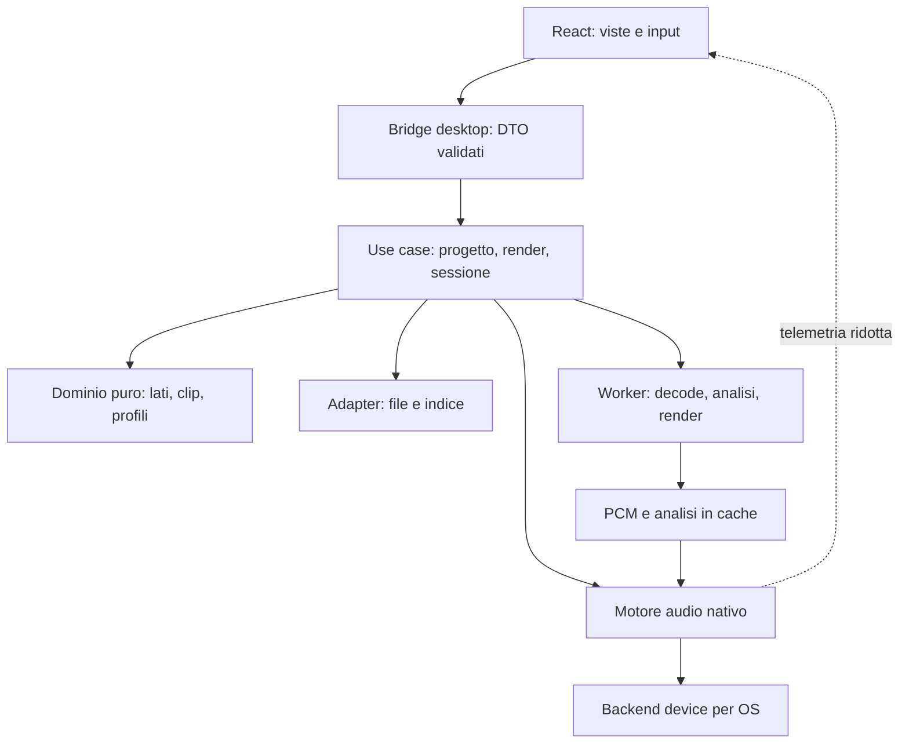

# Architettura desktop ibrida

Stato: proposta iniziale, da confermare con R0. Qui “ibrida” significa **UI web incorporata e servizi/audio nativi** su Windows, Linux e macOS. Non implica un servizio cloud né promette le stesse capacità nel browser.

## Scelta proposta e alternative

| Soluzione | Vantaggi per questo prodotto | Costo e rischio | Decisione |
| --- | --- | --- | --- |
| Tauri 2 + React/TypeScript + Rust | Riutilizzo del linguaggio visivo CSS; dominio e audio fuori dal thread UI; confine nativo esplicito | WebView differenti; richiede Rust e verifica backend audio | Prima candidata |
| Electron + UI web + motore nativo | Runtime Chromium uniforme; ecosistema web | Runtime distribuito e moduli nativi da mantenere; audio comunque da risolvere | Riserva per limiti concreti delle WebView |
| JUCE/C++ con UI nativa o shell web | Tooling audio e device dedicato | C++/FFI/build e condizioni di distribuzione da valutare; UI web richiede bridge | Riserva per il motore audio |
| Flutter + motore nativo | UI desktop condivisa | Nuovo stack Dart; meno riuso diretto del CSS, audio specialistico comunque nativo | Non prioritario |
| Solo Web Audio/PWA | Prototipazione rapida | Controllo driver/esclusività e affidabilità del trasferimento non sufficientemente garantiti | Eventuale demo, non riferimento audio desktop |

Questa scelta è un giudizio progettuale, non un benchmark già svolto. Tauri separa core e WebView e offre permessi per il bridge: [process model](https://v2.tauri.app/concept/process-model/), [capabilities](https://v2.tauri.app/security/capabilities/).

## Stack candidato

- **UI:** React, TypeScript strict, Vite, CSS con token semantici, componenti accessibili e Canvas per scope/spettro. Stato di presentazione locale; evitare un grande store aggiornato a frequenza audio.
- **Desktop:** Tauri 2, menu/file dialog/scorciatoie tramite adattatori nativi e permessi circoscritti.
- **Dominio/applicazione:** Rust; unico proprietario del progetto persistente e delle regole di durata. TypeScript riceve DTO/read model, non una seconda implementazione delle regole.
- **Audio I/O:** CPAL dietro `AudioDeviceBackend`, selezionato solo dopo gli spike. Le capacità dei backend dipendono dalla versione scelta. [CPAL](https://github.com/RustAudio/cpal)
- **Decode:** Symphonia per i formati verificati nella release fissata; FFmpeg opzionale per lacune misurate. Non attivare tutti i codec per abitudine. [Symphonia](https://github.com/pdeljanov/Symphonia)
- **DSP:** moduli Rust piccoli con test numerici; eventuali librerie selezionate per licenza, precisione e manutenzione. Nessun numero di versione inventato in questa fase.
- **Persistenza:** manifest JSON versionato per progetto; SQLite soltanto per indice locale/cache se necessario.
- **Qualità:** Vitest/Testing Library per UI, test Rust e property test per dominio/DSP, Playwright per UI web; smoke test del pacchetto desktop reale separati.

## Confini



La dipendenza del dominio punta soltanto a tipi e regole proprie. Storage, Tauri, decoder e driver implementano porte definite dal nucleo. Un modulo non può aprire device o file da una funzione di calcolo della durata.

## Pattern adottati perché utili

| Pattern | Applicazione concreta | Limite |
| --- | --- | --- |
| Modular monolith + ports/adapters | `project`, `media`, `mastering`, `calibration`, `session`, `artwork` con confini pubblici | Nessun microservizio locale |
| Command/use case | Una modifica produce revisione, eventi e stato coerente; comandi reversibili per editing | Undo non finge di annullare una registrazione fisica |
| State machine | Sessione e job hanno transizioni valide, pause ed errori espliciti | Non usare booleani `playing/recording/busy` contraddittori |
| Strategy | Fit, normalizzazione e backend intercambiabili | Niente plugin framework generico anticipato |
| Repository | Salvataggio progetto e cache dietro porte semplici | Nessun ORM nel DSP |
| Snapshot immutabile + revisione | Job e renderer lavorano su configurazione congelata | Niente event sourcing completo senza necessità |
| Producer/consumer con buffer limitati | Audio, decoder e telemetria comunicano senza bloccare callback | Una coda infinita nasconde sovraccarico |

## Organizzazione prevista

```text
apps/desktop/             shell Tauri, menu, capabilities, composizione
apps/desktop/ui/          feature UI e navigazione
packages/design-system/   token e componenti, esempi visivi
crates/domain/            progetto, clip, lati, unità, invarianti
crates/application/       use case, job, coordinamento sessione
crates/audio-engine/      trasporto, grafo DSP, renderer
crates/audio-io/          backend device e capacità per piattaforma
crates/media/             decode, resampling e analisi
crates/storage/           manifest, migrazioni, cache e indice
crates/contracts/         DTO e generazione tipi TypeScript
tests/fixtures/           segnali sintetici e media utilizzabili nei test
tests/hardware/           runbook, risultati e configurazioni
docs/                    specifiche, ADR e roadmap
```

È una mappa di responsabilità, non l'obbligo di creare subito ogni crate. Accorpare moduli piccoli finché build e confini restano comprensibili. Separare soltanto ciò che ha dipendenze, test o ciclo di vita differenti.

## Concorrenza e proprietà dello stato

1. I comandi di modifica progetto sono serializzati dall'application layer e validati nel dominio.
2. I job pesanti ricevono snapshot e revisione; i risultati obsoleti non sovrascrivono revisioni successive.
3. La callback audio usa memoria preallocata: niente file I/O, JSON, log, lock contesi o allocazioni.
4. I worker preparano PCM/grafi; il motore cambia piano a confine sicuro con smoothing dei parametri.
5. La UI riceve telemetria aggregata a 20–30 Hz. Il tempo di registrazione deriva dal contatore campioni, non da un timer JavaScript.
6. Una sessione attiva usa un piano congelato; modifiche successive del progetto richiedono nuova preparazione.

## Bridge e sicurezza locale

Il bridge espone operazioni del dominio con input strutturati e validati; nessun comando shell arbitrario, SQL libero o percorso accettato senza controlli. File accessibili tramite selezione esplicita e identificatori gestiti dal core. CSP restrittiva, asset locali, nessun contenuto remoto eseguibile. I metadati musicali sono input non fidato.

Eventuali processi FFmpeg usano argomenti separati, binario noto, nessuna concatenazione shell, protocolli di rete disabilitati dove possibile e limiti di risorse. Distribuire un sidecar comporta pacchetti per target e manutenzione: [Tauri external binaries](https://v2.tauri.app/develop/sidecar/), [licenze FFmpeg](https://ffmpeg.org/legal.html).

Nessun backend HTTP, account o contratto di API remoto è necessario in questa fase. Le eventuali integrazioni streaming/cloud saranno progettazioni separate.

## Regole di sviluppo

- Funzioni di dominio pure e unità esplicite: campioni, Hz, dBFS, dBTP, LUFS, millisecondi e millimetri non sono numeri intercambiabili.
- Errori tipizzati con codice stabile e messaggio localizzabile; evitare `catch` silenziosi e fallback invisibili.
- Dipendenze fissate con lockfile; aggiornamenti piccoli, motivati e verificati.
- Nessun modulo globale che possieda contemporaneamente UI, file, audio e persistenza.
- Astrarre i confini variabili, non ogni funzione; evitare cartelle `utils` come destinazione universale.
- Ogni feature include stati vuoto/caricamento/errore/annullamento e documenta i limiti hardware.
- Commenti per decisioni e vincoli, non per riscrivere il codice in prosa.
