# Progettazione del motore audio

Obiettivo: riprodurre o esportare esattamente il programma preparato, rendere visibili i livelli e supportare misure analogiche con requisiti dichiarati. Nessuna prestazione qui indicata è già stata misurata.

## Percorso del segnale

```mermaid
flowchart LR
  File[File locale] --> Decode[Decode e mappa canali]
  Decode --> SRC[Resampling alla frequenza progetto]
  SRC --> Edit[Trim, gain clip, fade e transizioni]
  Edit --> Master[Normalizzazione e dinamica]
  Master --> EQ[Traduzione EQ opzionale]
  EQ --> NR[Encoding NR opzionale]
  NR --> Render[Master portabile per lato]
  Render --> DeviceDSP[Trattamento specifico sessione, eventuale predistorsione]
  DeviceDSP --> Output[Mapping e uscita nativa]
  Input[Ritorno analogico] --> Align[Allineamento e misura]
  Output -. riferimento prima del DAC .-> Align
  Align --> View[Meter, confronto e report]
```

L'ordine di mastering/EQ/NR è un'ipotesi da validare per ciascun processore. L'ordine **NR → predistorsione** è un requisito esplicito per il caso analogo al PDRS descritto da MixtapeNerd. Nessun limiter o gain automatico dopo NR se altera l'encoding; eventuali sforamenti richiedono una nuova preparazione a monte. [Manuale PDRS](https://www.anaxwaves.com/MixtapeNerd/Docs/PDRS.html)

### Stesso render per ascolto ed export

Un unico grafo produce preview e master; niente normalizzazione separata nel frontend. Per registrare si preferisce pre-renderizzare ogni lato su disco in floating point e leggerlo con prefetch. Riduce il lavoro DSP durante il trasferimento, ma richiede controllo spazio e cache. Non si caricano 90 minuti di PCM interamente in RAM.

Il master portabile esclude correzioni specifiche della sessione. Il riferimento per il confronto off-tape è prelevato dopo tutti i trattamenti effettivamente inviati al DAC, salvo modalità di confronto esplicitamente diversa. I punti di misura devono essere selezionabili e nominati.

## Tempi e capienza

- Sorgenti con frequenze diverse conservano i propri frame originali; la timeline usa campioni interi alla frequenza progetto.
- Gli arrotondamenti avvengono durante la compilazione del piano, con una sola regola documentata. UI in `mm:ss`, dettaglio a millisecondi/campioni.
- Per un lato: `N = leader + Σ clip_effettive + Σ gap − Σ sovrapposizioni + trailer`.
- Ogni coppia adiacente ha un gap oppure una sovrapposizione; evitare doppio conteggio. Fade interni al clip non ne cambiano la durata.
- Capacità utilizzabile: campioni della durata effettiva dichiarata meno margine di sicurezza. La lunghezza nominale C60/C90 non è una misura del nastro inserito.
- Un tono separato non consuma il lato musicale. Se inserito nella sequenza, entra nel budget e compare nella tracklist tecnica.

Il fit non tronca un brano senza consenso espresso. Modalità iniziali: conserva ordine e scegli il punto di cambio; redistribuisci rispettando blocchi; massimizza riempimento con suggerimenti alternativi. Il problema combinatorio usa euristiche con tempo massimo e risultato deterministico a parità di input. Se impossibile, mostra eccedenza e opzioni; niente risultato dichiarato ottimo senza prova.

## Livelli e misuratori

| Misura | Significato nel prodotto | Requisito |
| --- | --- | --- |
| Sample peak dBFS | Massimo dei campioni digitali | Scala e canale espliciti, clip latch |
| True peak dBTP | Stima dei picchi fra campioni | Algoritmo verificato con segnali di riferimento |
| RMS dBFS | Energia su finestra dichiarata | Convenzione RMS esplicita: sinusoide full scale circa −3,01 dBFS con riferimento al picco numerico |
| LUFS I/S/M | Loudness integrata/breve/momentanea | Implementazione coerente con BS.1770, gating e finestre documentati |
| VU relativo | Livello medio riferito a una calibrazione | Definire risposta temporale e punto 0; non chiamare VU una barra FFT |
| PPM | Picco con risposta temporale specifica | Dichiarare variante/ballistic; niente sigla generica senza specifica |
| Spettro FFT | Distribuzione in frequenza | Hz, scala log, dB e punto di prelievo; non sostituisce il meter di livello |

Riferimento loudness/true peak: [ITU-R BS.1770-5](https://www.itu.int/rec/R-REC-BS.1770-5-202311-I/). Per VU/PPM occorre ancora fissare la specifica normativa e i segnali di verifica prima di dichiarare conformità.

Target iniziali di verifica, da confermare in R0: errore sample peak ≤0,05 dB; loudness integrata entro 0,1 LU rispetto al riferimento sui casi concordati; true peak entro 0,2 dB sui vettori scelti. Non sono certificazioni né sostituiscono le tolleranze previste dagli standard.

La normalizzazione LUFS applica un gain statico; se il target viola il ceiling, propone target più basso o dinamica esplicita. Preservare il bilanciamento L/R e offrire album gain. Non esiste un target LUFS universale per ogni cassetta.

## Calibrazione e profili

Tre livelli di esperienza:

1. **Guidata:** collegamenti, brano forte/tono, regolazione manuale sul deck, prova breve e ascolto.
2. **Allineata:** associazione fra un livello digitale dichiarato e il riferimento del meter analogico; profilo salvato.
3. **Misurata:** ritorno ADC, misura di MOL/SNR/HD3/risposta con banda, frequenza, pesatura e soglie registrate.

Le modalità sono una proposta UX; non devono ereditare meccanicamente i nomi di calibrazione del concorrente. Un deck a due testine permette test record–rewind–play, non confronto simultaneo dal nastro.

Un profilo include DAC/ADC, backend, identificatori device, canali, sample rate, modalità, gain digitale, posizione dichiarata dei controlli fisici, deck, nastro, data, metodo e risultati grezzi. Il sistema rileva ciò che può: un cambio del potenziometro fisico non è osservabile senza hardware. Chiedere conferma della catena all'avvio della sessione, evitando di presentare tale conferma come nuova misura.

Cambiare percorso, frequenza o livelli invalida la verifica precedente. Stato del profilo: `stimato`, `misurato`, `da riconfermare`, `incompatibile`. Il riferimento 0 VU non equivale a 0 dBFS e può differire dalla tacca Dolby del deck.

## Device per piattaforma

| Piattaforma | Percorso candidato | Cosa provare prima di prometterlo |
| --- | --- | --- |
| Windows | WASAPI shared; exclusive se disponibile; ASIO opzionale | Richiesta/ottenimento, sample rate reale, driver diversi, media key |
| macOS | CoreAudio | Configurazione stream, permessi ingresso, eventuale hog mode, cambio device |
| Linux | ALSA; integrazione PipeWire/PulseAudio/JACK secondo backend/versione | Routing, device occupato, sample rate effettivo e dipendenze del pacchetto |

La documentazione [CPAL](https://github.com/RustAudio/cpal) elenca backend distinti per OS; la presenza nella libreria non prova che l'app abbia già esclusività o ogni modalità richiesta. Il gate R0 confronta una release fissata con le necessità reali. Se insufficiente: adapter nativo mirato oppure motore JUCE, con ADR prima dell'introduzione di FFI.

Niente fallback silenzioso verso l'altoparlante di sistema quando il DAC si scollega. Il Bluetooth può essere selezionato per ascoltare, ma una sessione certificata richiede un percorso cablato testato. Non promettere “bit-perfect” senza verifica del percorso completo.

## Trasporto e guasti

Il clock è quello del dispositivo audio. La UI mostra posizione dal contatore dei frame; buffer e latenza del driver sono contabilizzati separatamente. Il countdown prepara l'utente, ma non sincronizza elettronicamente REC su un deck manuale.

- Buffer preallocati, code limitate e contatori underrun/overrun.
- Un underrun rende la sessione sospetta anche se i meter continuano a muoversi; registrare posizione e causa disponibile.
- Su disconnessione: arrestare l'uscita, conservare il log, chiedere di verificare il deck. Non riprendere automaticamente a metà nastro.
- Prima della riproduzione continua: bloccare il piano, verificare file/cache e spazio, predisporre l'inibizione sleep quando supportata.
- Tono di prova con avvio esplicito, durata limitata, livello visibile e Stop immediato. Mai emesso all'apertura di una pagina.

## Off-tape e ricerca

Il ritorno non va rimandato all'uscita che alimenta lo stesso deck. L'ascolto del ritorno richiede canali/device monitor separati o routing esplicitamente sicuro. L'allineamento usa correlazione, stima del ritardo e controllo della deriva tra clock ADC/DAC; se il segnale non consente una stima affidabile, sospende il giudizio invece di mostrare un errore fittizio.

MOL/SNR richiedono una procedura riproducibile. HD3 non è THD+N: visualizzarli separatamente e registrare quanto contribuisce l'interfaccia. La predistorsione resta sperimentale finché non migliora misure e ascolto su più deck, formulazioni e livelli. Non estendere un risultato su sinusoide a tutta la musica.
