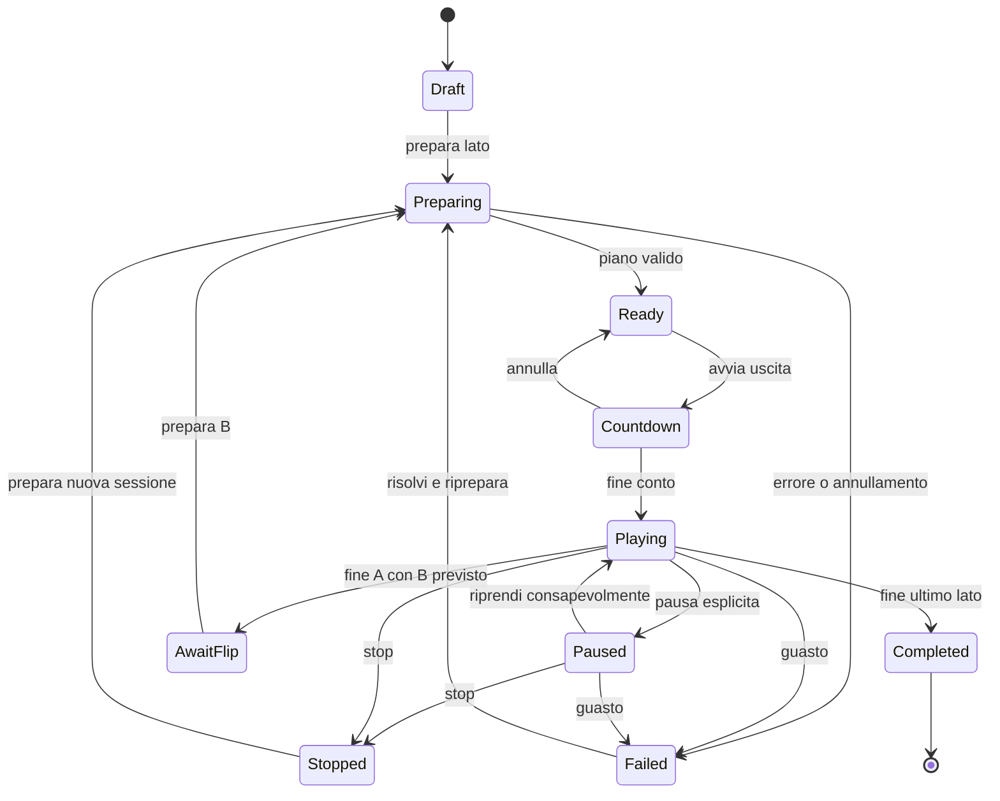

# Schermate e flussi operativi

> Revisione implementata: [16 — Interfaccia compatta](16-interfaccia-compatta.md) sostituisce la navigazione iniziale a sei schermate con Mixtape e Copertina, più pannelli contestuali. Le specifiche sotto restano riferimento storico dove divergono.

Proposta UX iniziale. I wireframe fissano gerarchia e comportamento, non rappresentano screenshot di un'app esistente. Riferimenti visivi in [design system](07-design-system.md).

## Navigazione

**Progetti → Componi → Mastering → Studio → Copertina.** Impostazioni audio e guida accessibili dalla shell. Calibrazione come flusso dedicato richiamabile da Mastering/Studio; laboratorio avanzato separato dai passi per principianti.

Il progetto rimane lo stesso tra le sezioni. Trasporto compatto persistente durante l'ascolto; Studio espande i controlli. La navigazione non interrompe l'audio, salvo azioni che richiedono ricompilare il piano attivo.

## Inventario schermate

| Schermata | Scopo e azione principale | Stati da progettare |
| --- | --- | --- |
| S-01 Progetti | Nuovo progetto, apri o recupera | Primo avvio, recenti vuoti, file spostato, recupero crash |
| S-02 Nuovo progetto | Titolo, durata A/B, formato, margine | Valori nominali/custom, percorso non scrivibile |
| S-03 Componi | Importa, ordina, verifica capienza e fit | Analisi in corso, audio mancante, overflow, proposta fit |
| S-04 Dettaglio clip | Trim, fade, gain e transizione | Gapless, durata invalida, file sostituito |
| S-05 Mastering | Misure, processori e ascolto confrontato | Non analizzato, target non raggiungibile, render obsoleto |
| S-06 Calibrazione | Connessioni, toni, riferimenti e profilo | Solo uscita, ritorno presente, due/tre testine, permesso negato |
| S-07 Laboratorio | MOL/SNR, bias, HD3 e risposta | Segnale insufficiente, loop non calibrato, funzione sperimentale |
| S-08 Studio | Prepara e avvia uscita verso il deck | Preflight, countdown, attivo, flip, fine, underrun/disconnessione |
| S-09 Esporta | Master per lato, toni e tracklist | Spazio insufficiente, clipping, nome già presente, annullamento |
| S-10 Copertina | J-card e scheda del nastro | Testi troppo lunghi, font mancante, scala stampa |
| S-11 Archivio sessioni | Esito, anomalie e configurazione usata | Nessuna sessione, interruzione, acquisizione da salvare |
| S-12 Impostazioni | Audio, temi, scorciatoie, cache e lingua | Device occupato, modalità non ottenuta, cache piena |

## S-03 — Componi

```text
┌ Cassette Maker · Night drive                 Salvato · Audio: USB DAC ┐
│ Progetti   │ Night drive                       [Importa] [Fit lati]    │
│ Componi ●  │ C90 · durata effettiva personalizzabile · margine 15 s    │
│ Mastering  ├─────────────────────────┬─────────────────────────────────┤
│ Studio     │ LATO A  42:17 / 44:45  │ LATO B  46:02 / 44:45          │
│ Copertina  │ Restano 02:28          │ Eccedenza 01:17 [Risolvi]        │
│            │ 01 Artist · Track      │ 01 Artist · Track              │
│            │ 02 Artist · Track 🔒   │ 02 Artist · Track              │
│            │ [+ Importa brani]      │ [+ Importa brani]              │
│            ├─────────────────────────┴─────────────────────────────────┤
│ Guida      │ Clip selezionata · trim · gap/fade · gain · blocco       │
├────────────┴───────────────────────────────────────────────────────────┤
│ [Play] [Stop] Lato A 00:00    waveform     L/R peak       [Apri Studio] │
└────────────────────────────────────────────────────────────────────────┘
```

La toolbar “Fit lati” apre una preview con ordine attuale e proposto, variazioni di gap/trim e vincoli rispettati. Applicazione in una transazione annullabile. Non elimina brani per farli entrare: può proporre esclusioni che l'utente deve scegliere. Su layout stretto A/B diventano tab; le due capienze rimangono in testata.

## S-05 — Mastering

```text
┌ Mastering · Piano da preparare                     [Prepara master] ┐
│ Sorgente: file selezionato / lato A / lato B                         │
├─────────────────────────────────┬───────────────────────────────────┤
│ Waveform e passaggi più forti   │ Catena processori                 │
│ [Peak] [RMS] [LUFS breve]       │ Normalizzazione: Peak / LUFS ... │
│ [Loop 5 s] contesto ±2 s        │ Target · guadagno applicabile    │
│                                │ Dinamica: bypass                 │
│ L/R meter · LUFS I · true peak  │ EQ / NR: avanzati                │
│ Spettro post-processing        │ Profilo: TDK D / deck / stato    │
├─────────────────────────────────┴───────────────────────────────────┤
│ [Originale / Processato] [Pareggia loudness ascolto] [Play] [Stop]   │
└─────────────────────────────────────────────────────────────────────┘
```

Il pareggiamento del volume è solo per l'ascolto comparativo e non altera il master. La comparazione Originale/Processato non va chiamata “A/B” senza spiegazione: A/B identifica già i lati del nastro. I nodi avanzati restano nascosti finché richiesti, con requisito hardware/calibrazione visibile.

## S-06 — Calibrazione

```text
┌ Calibra la catena · passo 2 di 4                                   ┐
│ Connessioni → Allinea livelli → Misura opzionale → Salva profilo    │
│ PC OUT ───► DECK LINE IN       DECK LINE OUT ───► PC IN (opzionale) │
│                                                                   │
│ Device e canali effettivi                                         │
│ Tono: 1 kHz · livello digitale esplicito · durata 5 s               │
│ [Riproduci tono] [Stop]    “Regola il livello sul deck”             │
│ Meter L/R e riferimento dichiarato                                │
│ [Indietro]                                 [Continua]             │
└───────────────────────────────────────────────────────────────────┘
```

Passo 1 controlla la configurazione; passo 2 allinea; passo 3 offre misura con requisiti soddisfatti o prova record–rewind–play; passo 4 salva metodo e stato. Tornare indietro non lascia un tono attivo. Nessun requisito di ingresso per chi vuole soltanto compilare/esportare.

## S-08 — Studio

```text
┌ Studio · Night drive                          USB DAC · 48 kHz    ┐
│ LATO A · master pronto · 42:17 · profilo misurato, da confermare   │
├───────────────────────────────────┬───────────────────────────────┤
│ 00:00 / 42:17                     │ PREPARAZIONE                  │
│ Cassetta compatta + waveform      │ ✓ File e piano disponibili   │
│                                  │ ✓ Device presente            │
│ L/R Peak [unità e scala]          │ ? Catena fisica confermata   │
│ VU [riferimento]                  │ [Verifica configurazione]    │
│ Spettro                          │                               │
│ Source / Return, se disponibile   │ Premi REC sul deck, poi      │
│                                  │ [Avvia uscita · countdown]   │
├───────────────────────────────────┴───────────────────────────────┤
│ [STOP]  Audio in uscita: fermo · Nastro: stato manuale             │
└───────────────────────────────────────────────────────────────────┘
```

Durante la sessione: Stop sempre visibile; device, piano e profilo congelati; errori registrati. Pausa disponibile come comando esplicito, ma avverte che il nastro continua a muoversi finché il deck non viene fermato. Il percorso guidato usa Stop e nuova preparazione per ripartenze affidabili.

Fine lato A: uscita arrestata, messaggio “Ferma il deck, gira la cassetta e prepara il lato B”; nessun autoplay del lato B senza azione. Se il deck ha autoreverse, il supporto va progettato come modalità separata con tempi/hardware testati.

## S-10 — Copertina

```text
┌ Copertina · Night drive                         [Esporta PDF]     ┐
│ Template: classico  [A4 / Letter] [Scala: 100%]                   │
├─────────────────────────────────┬────────────────────────────────┤
│ Anteprima J-card in mm          │ Titolo, autore, data, note      │
│ Fronte · dorso · retro          │ Artwork locale                 │
│ Tracklist A/B dal progetto      │ Font e colori                  │
│ Linee taglio/piega              │ Avviso: testo fuori area       │
│ Barra di riscontro 50 mm        │ [Sincronizza tracklist]         │
└─────────────────────────────────┴────────────────────────────────┘
```

Template con quote esplicite e prova fisica; non assumere che tutte le custodie siano identiche. Stampa a dimensione reale con barra di controllo; mai correggere la scala in silenzio per far entrare il contenuto. Anche in tema scuro l'anteprima mostra i colori della stampa.

## Flussi principali

**Primo uso:** nuovo progetto → importa → verifica A/B → prepara → scegli export oppure Studio → allinea il deck → registra A → gira → registra B → salva report e stampa. La calibrazione avanzata non è obbligatoria per il percorso semplice.

**Utente esperto:** apri profilo → verifica catena → analizza/loop picchi → imposta dinamica/EQ/NR disponibili → prepara → off-tape → report. Una variazione di device rende evidente la necessità di riconfermare o rimisurare.

**Solo master:** componi → mastering → export; nessun permesso microfono e nessun device fisico obbligatorio.

**Errore hardware:** perdita device → arresto controllato → avviso di fermare il deck → log posizione → verifica connessione → nuova sessione da punto scelto esplicitamente. Nessuna promessa di continuità fisica dopo il guasto.

## Stati della sessione



Il log conserva segmento e posizione in ogni pausa/ripresa. Un render cancellato è un esito del job distinto da un guasto audio, anche se il wireframe compatto usa lo stesso pannello per la spiegazione.
